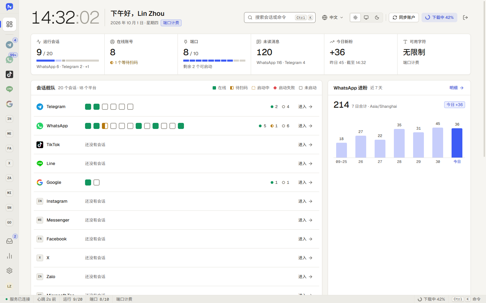
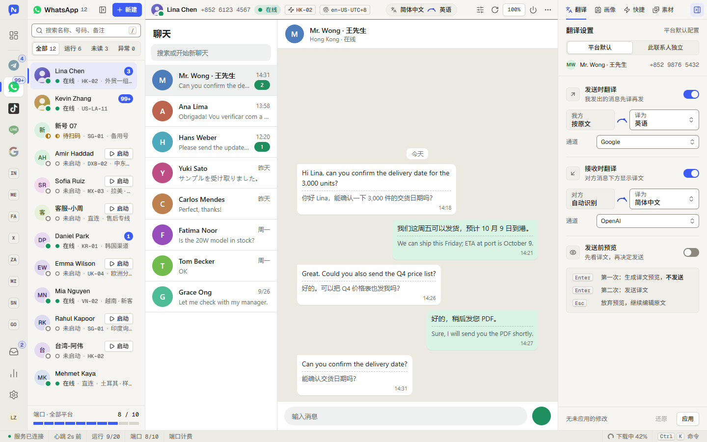
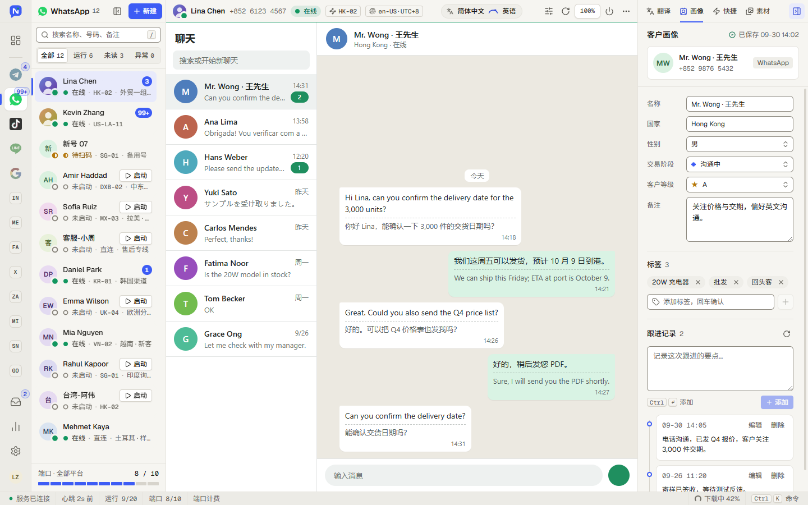
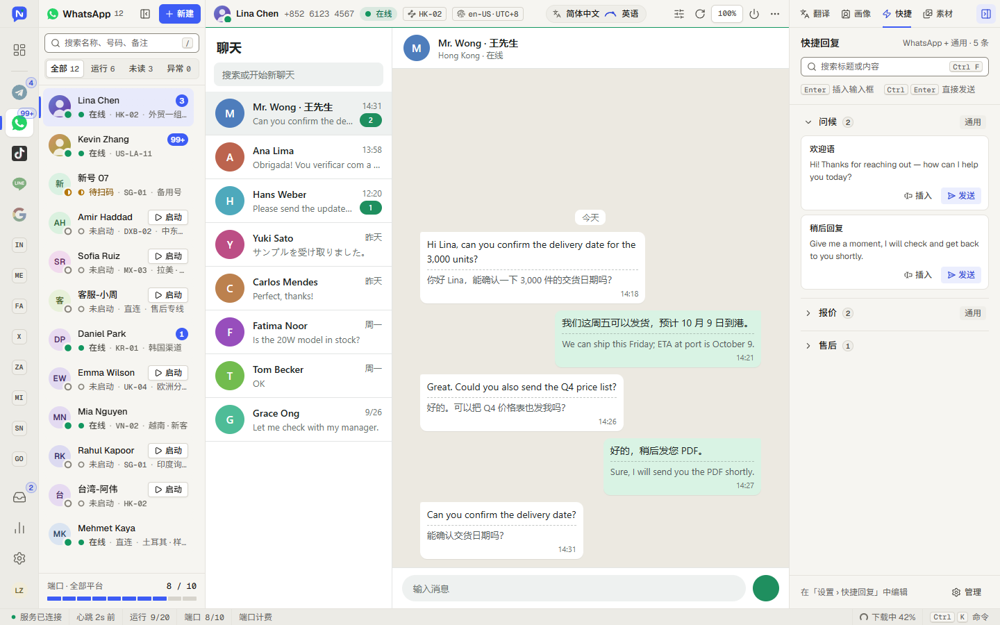
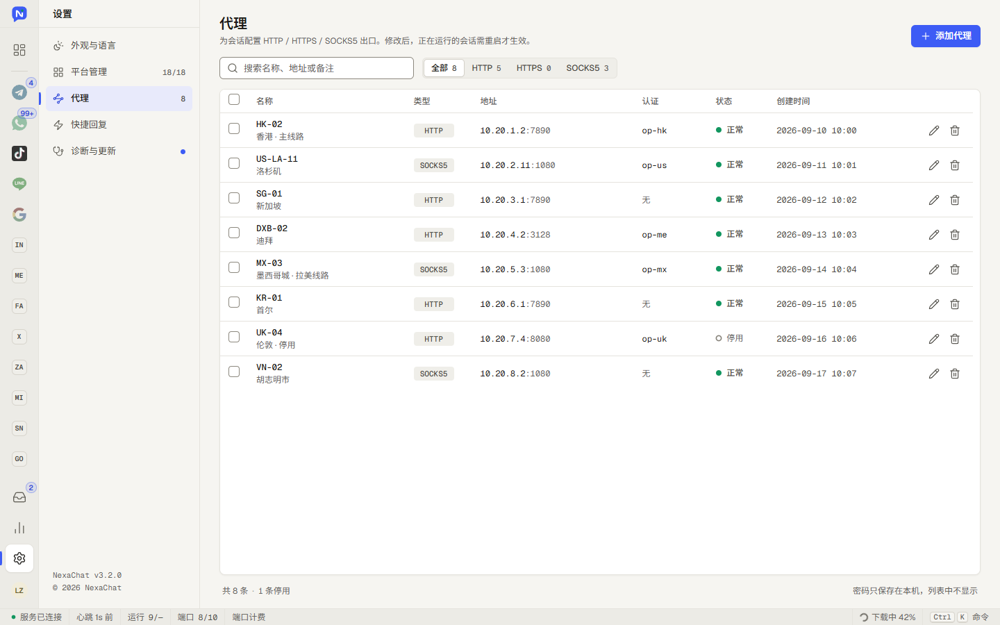
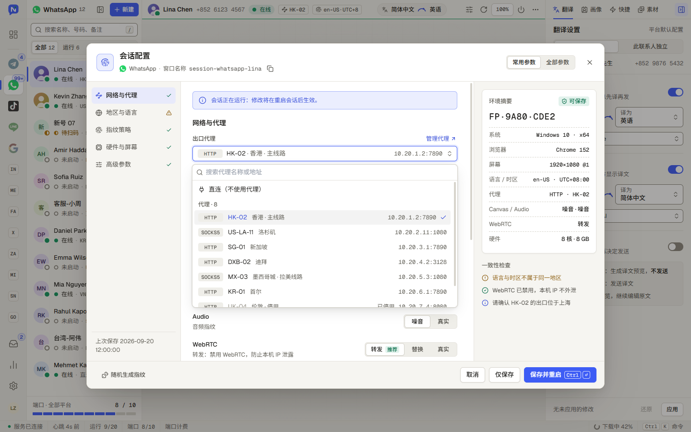

# NexaChat 3.2

NexaChat 是面向 WhatsApp、Telegram 等平台的多账号桌面工作台。3.2 版已完成客户端重构：统一工作台管理多个平台与会话，并将会话浏览器、账号配置和工作台工具整合到一套界面中。

> **全套源码交付 · 定制化部署**：支持自主维护与二次开发，可按品牌和业务需求沟通部署及定制方案。咨询请联系 Telegram：[@zhonghe785](https://t.me/zhonghe785)。

## 功能概览

- **多平台、多账号会话**：在一个工作台中切换平台、创建和管理多个独立会话；会话支持启动、停止、批量操作与状态查看。
- **独立会话环境**：会话各自保存站点数据，可分别配置代理、浏览器指纹、地区、语言及时区等参数。
- **聊天辅助工具**：按平台能力提供发送与接收翻译、翻译预览、语音转文字、AI 回复、快捷回复、联系人画像与跟进记录、素材库等功能。
- **账号与运营管理**：提供账号同步、未读和运行状态、消息同步、WhatsApp 进粉统计、站内信与桌面通知等能力；实际可用功能依平台和服务端配置而异。
- **桌面工作流**：支持中英文界面、浅色与深色主题、命令面板、会话搜索、代理管理、客户端更新与诊断工具。

## 界面截图

以下截图由 NexaChat 3.2 客户端界面的离屏截图流程生成。截图使用隔离的演示数据和模拟主机，账号、聊天内容及代理信息均为虚构示例。

### 工作台



### 多账号聊天与实时翻译



### 联系人画像与跟进



### 快捷回复



### 代理管理



### 会话指纹与网络配置



## 平台与能力

平台入口由平台清单驱动。WhatsApp 和 Telegram 集成了主要聊天辅助能力；其他平台按各自接入状态提供会话浏览、翻译、画像或快捷回复等功能。可用能力可能因平台、客户端版本和服务端配置而不同。

## 技术架构

- **桌面界面**：Vue 3、TypeScript、Vite。
- **桌面主机**：Electron 主进程，搭配定制的 fingerprint-electron 运行时，为每个会话建立独立浏览器环境。
- **平台接入**：由平台清单、平台脚本和能力配置管理入口与平台差异。
- **服务端**：NexaChat 新后端提供客户端 API、管理台和后台任务。翻译、额度、消息同步等在线能力需要按部署配置接入服务端。

客户端支持 Windows x64 与 macOS Apple Silicon。部分平台能力需要服务端或对应平台服务配合；首次使用时请按实际部署信息登录并配置。

## 项目结构

新版客户端代码位于独立的 [NexaChat 仓库](https://github.com/LinguaBridge-scrm/nexa-chat) 中，主要目录如下：

| 目录 | 用途 |
|---|---|
| `electron/` | Electron 主进程、会话生命周期、持久化数据、代理与指纹配置 |
| `qd/` | Vue 桌面界面 |
| `platform/config/`、`platform/js/` | 平台清单、能力配置与平台适配脚本 |
| `server/` | NexaChat 后端与管理台 |
| `telegram-tt/` | 可选的 Telegram Web A 定制客户端 |

## 开发

需要 Node.js 22.13 或更高版本及 npm。首次运行还需安装项目指定的定制 Electron 运行时。

```powershell
npm --prefix qd ci
npm --prefix qd run build
cd electron
npm install
npm run runtime:install -- --download
npm run dev
```

更多构建、部署和运行说明请查看新版仓库中的 `AGENTS.md`、`electron/README.md`、`qd/README.md`、`server/README.md` 与 `DEPLOYMENT.md`。

## 全套源码与定制化部署

提供 NexaChat 全套源码交付与定制化部署服务，满足自主维护、二次开发和业务落地需求。

| 服务 | 内容 |
|---|---|
| 全套源码交付 | 提供软件源码，便于自主维护、功能扩展与二次开发；交付范围及版本可联系咨询。 |
| 定制化部署 | 根据品牌、运行环境和业务需求，沟通部署配置及功能定制方案。 |
| 软件体验与授权咨询 | 了解版本功能、体验方式与授权方案，选择适合业务需求的版本。 |

欢迎说明所需版本、使用场景及定制需求，我们将据此沟通交付和部署方案。[联系咨询](#联系方式)

## 免责声明

使用本项目及连接的第三方平台或翻译服务前，请自行确认相关平台条款、数据处理方式和部署要求。项目贡献者不保证软件适用于特定用途；使用者应自行承担使用风险与责任。

## 联系方式

咨询 **全套源码、定制化部署、软件体验与授权**，欢迎通过 Telegram 联系：

- Telegram：[@zhonghe785](https://t.me/zhonghe785)
- Telegram：[@LinkSengs](https://t.me/LinkSengs)
